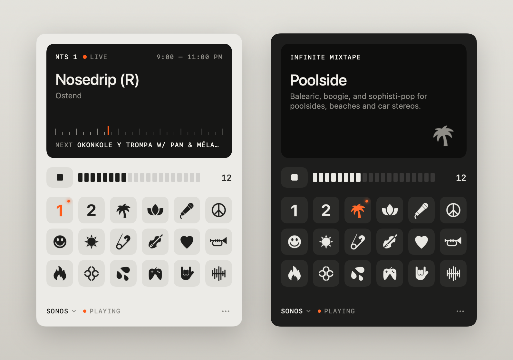

# atonemo-sonos

Play the [Atonemo NTS Radio Player](https://atonemo.com/products/nts) on Sonos.



Use the player as usual. Its stations, volume knob and stop button drive Sonos. Sonos streams straight from NTS and never starts music by itself.

## Mac

1. Download `AtonemoSonos.zip` from [Releases](../../releases). Unzip it and move the app to Applications.
2. Open it. If macOS blocks it: System Settings → Privacy & Security → Open Anyway.
3. Allow local network access.

Click the radio icon in the menu bar to pick a station or set the volume. Keys: ← → station, ↑ ↓ volume, Space play/stop.

## Raspberry Pi, Linux (Python 3.9+)

```sh
curl -O https://raw.githubusercontent.com/avxe/atonemo-sonos/main/atonemo_sonos.py
python3 atonemo_sonos.py --room "Living Room"
```

Start at boot: [atonemo-sonos.service](atonemo-sonos.service). Options: `--help`.

Run the bridge on one always-on device. Mac app plus a Pi? Turn off **Bridge on This Mac** in the ⋯ menu.

Unofficial. Not affiliated with Atonemo, NTS or Sonos. [MIT](LICENSE)
